# WildMatch AI — Architecture Diagrams & Specifications

This document contains the visual system diagrams for WildMatch AI.

---

## 1. End-to-End System & Project Pipeline

```mermaid
flowchart TD
    subgraph M1["MEMBER 1: Dataset Collection & Preprocessing"]
        INAT["iNaturalist API Harvest<br/>(CC-BY / CC-BY-SA)"]
        CUR["200 Curated Wildlife Images<br/>(50 Tiger, 50 Lion, 50 Elephant, 50 Chital)"]
        BLIP["BLIP Captioning &<br/>Manual Annotation Review"]
        SPLIT["Stratified Splitting (70/15/15)<br/>Train: 140 | Val: 30 | Test: 30"]
        VOCAB["158-Word Vocabulary<br/>(Fitted strictly on Train Split)"]
        IMG_PRE["Image Preprocessor<br/>EXIF Transpose + RGB +<br/>Letterbox Pad to 224x224 + ImageNet Norm"]
        TXT_PRE["Text Preprocessor<br/>Clean + Lowercase + Tokenize<br/>(PAD=0, UNK=1, BOS=2, EOS=3, L=32)"]
        DLOADER["PyTorch DataLoader API<br/>WildlifeDataset + create_dataloaders()"]

        INAT --> CUR --> BLIP --> SPLIT
        SPLIT --> VOCAB
        SPLIT --> IMG_PRE --> DLOADER
        VOCAB --> TXT_PRE --> DLOADER
    end

    subgraph M23["MEMBERS 2 & 3: Dual-Encoder Architecture & Contrastive Training"]
        IMG_BATCH["Image Tensors<br/>[B, 3, 224, 224]"]
        TXT_BATCH["Caption Tokens<br/>[B, 32]"]
        
        DLOADER -.->|Mini-batching| IMG_BATCH
        DLOADER -.->|Mini-batching| TXT_BATCH

        IMG_ENC["ResNet-18 Image Encoder<br/>(models/wildmatch_v3.py)<br/>512-d Visual Features"]
        TXT_ENC["BiLSTM Text Encoder<br/>(models/wildmatch_v3.py)<br/>128-d Word Emb + Masked Pooling"]

        IMG_PROJ["Visual Projection MLP<br/>512 -> 512 -> 256 + L2 Norm"]
        TXT_PROJ["Text Projection MLP<br/>256 -> 256 -> 256 + L2 Norm"]

        IMG_VEC["Visual Embedding v<br/>[B, 256] on Unit Sphere S^255"]
        TXT_VEC["Text Embedding t<br/>[B, 256] on Unit Sphere S^255"]

        IMG_BATCH --> IMG_ENC --> IMG_PROJ --> IMG_VEC
        TXT_BATCH --> TXT_ENC --> TXT_PROJ --> TXT_VEC

        LOSS_MOD["training/loss.py<br/>• Symmetric InfoNCE Loss<br/>• Species-Aware Multi-Positive Loss<br/>• Auxiliary Classification Loss"]
        TRAIN_PIPE["training/train.py<br/>• AdamW (lr_bb=1e-5, lr_heads=2e-4)<br/>• ReduceLROnPlateau Scheduler<br/>• 35 Epochs Optimization"]

        IMG_VEC --> LOSS_MOD
        TXT_VEC --> LOSS_MOD
        LOSS_MOD --> TRAIN_PIPE

        CKPT["Trained Checkpoints<br/>models/wildmatch_v3_dual_encoder.pth (45.8 MB)<br/>models/wildmatch_v3_species_heads.pth"]
        TRAIN_PIPE --> CKPT
    end

    subgraph M4["MEMBER 4: Retrieval Engine, Evaluation & Interactive App"]
        CKPT -.->|Load Weights| RETRIEVER
        
        RETRIEVER["retrieval.py (WildMatchRetriever)<br/>• Precomputed Gallery Vector Indexing<br/>• Cosine Similarity Matrix: S = v · t^T<br/>• Top-K Candidate Ranking"]
        
        EVAL["evaluation.py (Evaluation Suite)<br/>• Recall@1, Recall@5, Recall@10<br/>• Mean Reciprocal Rank (MRR)<br/>• Exact-Match & Species-Level Metrics"]

        RETRIEVER --> EVAL

        GRADIO["app.py (Gradio Web Application)<br/>• Tab 1: Text-to-Image Semantic Search<br/>• Tab 2: Image-to-Text Description Retrieval<br/>• Tab 3: Cross-Modal Pair Similarity Scorer<br/>• Tab 4: Performance & Analytics Dashboard"]

        RETRIEVER --> GRADIO
        EVAL --> GRADIO
    end
```

---

## 2. Detailed Model Architecture (Version 3 Dual-Encoder)

```mermaid
flowchart LR
    subgraph VisualStream["Visual Encoding Branch (ResNet-18 Backbone)"]
        direction TB
        IMG_IN["Input Image<br/>[B, 3, 224, 224]"] --> CONV1["Conv1 + BN + ReLU + MaxPool<br/>7x7 Conv (stride 2) -> [B, 64, 56, 56]"]
        CONV1 --> L1["Layer 1 (2 BasicBlocks)<br/>64-ch, stride 1 -> [B, 64, 56, 56]"]
        L1 --> L2["Layer 2 (2 BasicBlocks)<br/>128-ch, stride 2 -> [B, 128, 28, 28]"]
        L2 --> L3["Layer 3 (2 BasicBlocks)<br/>256-ch, stride 2 -> [B, 256, 14, 14]"]
        L3 --> L4["Layer 4 (2 BasicBlocks)<br/>512-ch, stride 2 -> [B, 512, 7, 7]"]
        L4 --> GAP["AdaptiveAvgPool2d((1, 1)) + Flatten<br/>[B, 512]"]
        GAP --> IMG_MLP["Projection Head (2-layer MLP)<br/>Linear(512 -> 512) -> ReLU -> Dropout(0.1)<br/>Linear(512 -> 256)"]
        IMG_MLP --> IMG_NORM["L2 Normalization (dim=-1)<br/>||v||_2 = 1.0 -> [B, 256]"]
    end

    subgraph TextStream["Textual Encoding Branch (BiLSTM Backbone)"]
        direction TB
        TXT_IN["Caption Token IDs<br/>[B, 32]"] --> EMB["Word Embedding Layer<br/>Embedding(158, 128, pad_idx=0)<br/>+ Dropout(0.1) -> [B, 32, 128]"]
        EMB --> LSTM["Bidirectional LSTM<br/>1 Layer, hidden_size=128 per dir<br/>Output: [B, 32, 256]"]
        LSTM --> POOL["Padding-Aware Masked Mean Pooling<br/>mask = (tokens != 0)<br/>h_pooled = sum(h * mask) / sum(mask)<br/>Output: [B, 256]"]
        POOL --> TXT_MLP["Projection Head (2-layer MLP)<br/>Linear(256 -> 256) -> ReLU -> Dropout(0.1)<br/>Linear(256 -> 256)"]
        TXT_MLP --> TXT_NORM["L2 Normalization (dim=-1)<br/>||t||_2 = 1.0 -> [B, 256]"]
    end

    subgraph JointSpace["Shared Latent Space S^255 & Multi-Task Losses"]
        direction TB
        IMG_NORM --> DOT["Cosine Similarity Matrix<br/>S = v · t^T  in [-1.0, 1.0]<br/>Shape: [B, B]"]
        TXT_NORM --> DOT

        DOT --> SCALE["Temperature Scaling<br/>scale = exp(clamp(logit_scale, max=ln(100)))<br/>Logits = scale * S"]

        SCALE --> CONTRAST["Species-Aware Multi-Positive InfoNCE<br/>Groups all in-batch images and captions<br/>sharing identical species as positive pairs<br/>L_contrast = (L_v2t + L_t2v) / 2"]

        IMG_NORM --> CLS_IMG["Auxiliary Image Classifier<br/>Linear(256 -> 4 Species)"]
        TXT_NORM --> CLS_TXT["Auxiliary Text Classifier<br/>Linear(256 -> 4 Species)"]
        
        CLS_IMG --> AUX_LOSS["Auxiliary Cross-Entropy Loss<br/>L_aux = 0.5 * (CE_img + CE_txt)"]
        CLS_TXT --> AUX_LOSS

        CONTRAST --> TOTAL_LOSS["Total Joint Training Objective<br/>L_total = L_contrast + 0.5 * L_aux"]
        AUX_LOSS --> TOTAL_LOSS
    end
```

