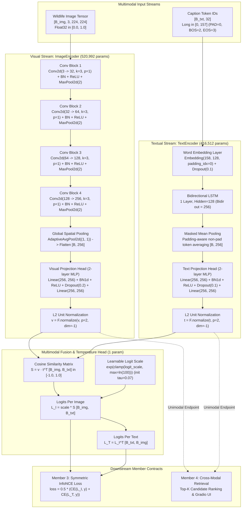

# WildMatch AI — Model Architecture Specification & Integration Contracts (Member 2)

> **Document Status:** FINAL  
> **Author:** Member 2 (Deep Learning / Model Architecture Specialist)  
> **Target Audience:** Member 3 (Training Engine / Loss Specialist), Member 4 (Retrieval, Evaluation & UI Specialist)  
> **Scope:** Custom CNN Image Encoder, BiLSTM Text Encoder, Unified DualEncoder, Contrastive Formulation, and Integration Contracts

---

## 1. Executive Summary

WildMatch AI is a multimodal image-text retrieval system designed to match Indian wildlife camera-trap imagery with descriptive natural-language field observations. Within the 4-member project division:
- **Member 1 (Data Engineer):** Curated 4-species dataset, tokenization pipeline, and PyTorch `WildlifeDataset` / `DataLoader`.
- **Member 2 (Model Architect — Current):** Designed, built, unit-tested, and verified the custom dual-encoder neural architecture mapping images `[B, 3, 224, 224]` and captions `[B, 32]` into a shared, calibrated 256-dimensional embedding space.
- **Member 3 (Training & Loss Engineer):** Trains the dual-encoder using symmetric InfoNCE contrastive loss, learning rate scheduling, and checkpoint serialization.
- **Member 4 (Retrieval & Application Engineer):** Indexes offline candidate galleries, calculates retrieval benchmarks (Recall@1, Recall@5, MRR), and presents an interactive Gradio search interface.

### Key Architectural Invariants
1. **Lightweight Parameter Footprint:** 937,505 parameters total (~0.94M, well below the 2.5M budget) requiring only ~3.58 MB FP32 memory.
2. **Deterministic Unimodal Endpoints:** Both image and text representations are projected into $\mathbb{R}^{256}$ and unit-normalized ($||v_i||_2 = 1.0, ||t_i||_2 = 1.0$).
3. **Calibrated Temperature Scaling:** Learnable parameter `logit_scale` initialized to $\ln(1 / 0.07) \approx 2.6593$ with upper bound clamping at $\ln(100) \approx 4.6052$ to prevent saturation.
4. **Flexible Batch Compatibility:** Supports both square training batches $[B, B]$ and rectangular retrieval batches $[B_{query}, B_{gallery}]$.

---

## 2. Architecture Diagrams

### 2.1 Complete System Architecture (Mermaid)



---

### 2.2 System Architecture ASCII Diagram

```text
====================================================================================================
                               WILDMATCH AI DUAL-ENCODER ARCHITECTURE
====================================================================================================

      [ Image Input ]                                               [ Caption Input ]
     [B_img, 3, 224, 224]                                             [B_txt, 32]
              │                                                            │
              ▼                                                            ▼
    ┌──────────────────┐                                         ┌──────────────────┐
    │   Conv Block 1   │ [B, 32, 112, 112]                       │  Word Embedding  │ [B, 32, 128]
    │ Conv3x3-BN-ReLU-P│                                         │ 158 x 128 (pad 0)│
    └─────────┬────────┘                                         └────────┬─────────┘
              ▼                                                            ▼
    ┌──────────────────┐                                         ┌──────────────────┐
    │   Conv Block 2   │ [B, 64, 56, 56]                         │ Bidirectional    │ [B, 32, 256]
    │ Conv3x3-BN-ReLU-P│                                         │ LSTM (Hidden 128)│
    └─────────┬────────┘                                         └────────┬─────────┘
              ▼                                                            ▼
    ┌──────────────────┐                                         ┌──────────────────┐
    │   Conv Block 3   │ [B, 128, 28, 28]                        │   Masked Mean    │ [B, 256]
    │ Conv3x3-BN-ReLU-P│                                         │     Pooling      │ (ignores <PAD>)
    └─────────┬────────┘                                         └────────┬─────────┘
              ▼                                                            ▼
    ┌──────────────────┐                                         ┌──────────────────┐
    │   Conv Block 4   │ [B, 256, 14, 14]                        │  2-Layer MLP     │ [B, 256]
    │ Conv3x3-BN-ReLU-P│                                         │ Linear-BN-ReLU-  │
    └─────────┬────────┘                                         │ Dropout-Linear   │
              ▼                                                  └────────┬─────────┘
    ┌──────────────────┐                                                  ▼
    │ AdaptiveAvgPool2d│ [B, 256, 1, 1]                          ┌──────────────────┐
    │    + Flatten     │ [B, 256]                                │ L2 Normalization │ [B, 256]
    └─────────┬────────┘                                         │  ||t_i||_2 = 1.0 │
              ▼                                                  └────────┬─────────┘
    ┌──────────────────┐                                                  │
    │  2-Layer MLP     │ [B, 256]                                         │
    │ Linear-BN-ReLU-  │                                                  │
    │ Dropout-Linear   │                                                  │
    └─────────┬────────┘                                                  │
              ▼                                                           │
    ┌──────────────────┐                                                  │
    │ L2 Normalization │ [B, 256]                                         │
    │  ||v_i||_2 = 1.0 │                                                  │
    └─────────┬────────┘                                                  │
              │                                                           │
              └─────────────────────────────┬─────────────────────────────┘
                                            ▼
                           ┌─────────────────────────────────┐
                           │   Cosine Similarity Matrix      │
                           │   S = v · t^T  [B_img, B_txt]   │
                           │   Bounded in [-1.0, 1.0]        │
                           └────────────────┬────────────────┘
                                            │
                                            ▼  <── Scaled by exp(logit_scale) (~14.29)
                           ┌─────────────────────────────────┐
                           │   Symmetric Contrastive Logits  │
                           │   L_I = scale * S               │
                           │   L_T = L_I^T                   │
                           └────────────────┬────────────────┘
                                            │
                    ┌───────────────────────┴───────────────────────┐
                    ▼                                               ▼
         [ Member 3: InfoNCE Loss ]                      [ Member 4: Retrieval ]
       0.5 * (CE(L_I, y) + CE(L_T, y))                  Top-K Indexing & Gradio UI
====================================================================================================
```

---

## 3. Comprehensive Layer-by-Layer Breakdown

### 3.1 ImageEncoder Specification

- **Module Name:** `WildMatch_AI.models.image_encoder.ImageEncoder`
- **Total Parameters:** 520,992 (~521K params)
- **Trainable Parameters:** 520,992 (100%)
- **Input Specification:** `[B, 3, 224, 224]` float32 tensor with pixel values in range $[0.0, 1.0]$.
- **Output Specification:** `[B, 256]` float32 tensor with unit L2 norm ($||v_i||_2 = 1.0 \pm 10^{-5}$).

| Stage / Layer Name | PyTorch Component | Kernel / Stride / Pad | Input Shape | Output Shape | Param Count |
|-------------------|-------------------|-----------------------|-------------|--------------|-------------|
| **Backbone Block 1** | | | | | |
| `block1.0` | `nn.Conv2d(3, 32)` | $3 \times 3$, $s=1$, $p=1$, bias=F | `[B, 3, 224, 224]` | `[B, 32, 224, 224]` | 864 |
| `block1.1` | `nn.BatchNorm2d(32)` | $\gamma, \beta$ affine | `[B, 32, 224, 224]` | `[B, 32, 224, 224]` | 64 |
| `block1.2` | `nn.ReLU(inplace=True)` | Elementwise | `[B, 32, 224, 224]` | `[B, 32, 224, 224]` | 0 |
| `block1.3` | `nn.MaxPool2d(2, 2)` | $2 \times 2$, $s=2$ | `[B, 32, 224, 224]` | `[B, 32, 112, 112]` | 0 |
| **Backbone Block 2** | | | | | |
| `block2.0` | `nn.Conv2d(32, 64)` | $3 \times 3$, $s=1$, $p=1$, bias=F | `[B, 32, 112, 112]` | `[B, 64, 112, 112]` | 18,432 |
| `block2.1` | `nn.BatchNorm2d(64)` | $\gamma, \beta$ affine | `[B, 64, 112, 112]` | `[B, 64, 112, 112]` | 128 |
| `block2.2` | `nn.ReLU(inplace=True)` | Elementwise | `[B, 64, 112, 112]` | `[B, 64, 112, 112]` | 0 |
| `block2.3` | `nn.MaxPool2d(2, 2)` | $2 \times 2$, $s=2$ | `[B, 64, 112, 112]` | `[B, 64, 56, 56]` | 0 |
| **Backbone Block 3** | | | | | |
| `block3.0` | `nn.Conv2d(64, 128)` | $3 \times 3$, $s=1$, $p=1$, bias=F | `[B, 64, 56, 56]` | `[B, 128, 56, 56]` | 73,728 |
| `block3.1` | `nn.BatchNorm2d(128)` | $\gamma, \beta$ affine | `[B, 128, 56, 56]` | `[B, 128, 56, 56]` | 256 |
| `block3.2` | `nn.ReLU(inplace=True)` | Elementwise | `[B, 128, 56, 56]` | `[B, 128, 56, 56]` | 0 |
| `block3.3` | `nn.MaxPool2d(2, 2)` | $2 \times 2$, $s=2$ | `[B, 128, 56, 56]` | `[B, 128, 28, 28]` | 0 |
| **Backbone Block 4** | | | | | |
| `block4.0` | `nn.Conv2d(128, 256)` | $3 \times 3$, $s=1$, $p=1$, bias=F | `[B, 128, 28, 28]` | `[B, 256, 28, 28]` | 294,912 |
| `block4.1` | `nn.BatchNorm2d(256)` | $\gamma, \beta$ affine | `[B, 256, 28, 28]` | `[B, 256, 28, 28]` | 512 |
| `block4.2` | `nn.ReLU(inplace=True)` | Elementwise | `[B, 256, 28, 28]` | `[B, 256, 28, 28]` | 0 |
| `block4.3` | `nn.MaxPool2d(2, 2)` | $2 \times 2$, $s=2$ | `[B, 256, 28, 28]` | `[B, 256, 14, 14]` | 0 |
| **Spatial Pooling** | | | | | |
| `pool` | `nn.AdaptiveAvgPool2d((1, 1))` | Global pooling | `[B, 256, 14, 14]` | `[B, 256, 1, 1]` | 0 |
| `flatten` | `nn.Flatten(1)` | Spatial collapse | `[B, 256, 1, 1]` | `[B, 256]` | 0 |
| **Projection Head** | | | | | |
| `projection_head.0` | `nn.Linear(256, 256)` | Dense linear with bias | `[B, 256]` | `[B, 256]` | 65,792 |
| `projection_head.1` | `nn.BatchNorm1d(256)` | Affine 1D normalizer | `[B, 256]` | `[B, 256]` | 512 |
| `projection_head.2` | `nn.ReLU(inplace=True)` | Non-linear activation | `[B, 256]` | `[B, 256]` | 0 |
| `projection_head.3` | `nn.Dropout(p=0.2)` | Regularization | `[B, 256]` | `[B, 256]` | 0 |
| `projection_head.4` | `nn.Linear(256, 256)` | Final projection linear | `[B, 256]` | `[B, 256]` | 65,792 |
| **Normalization** | `F.normalize(x, p=2, dim=-1)` | L2 Euclidean sphere | `[B, 256]` | `[B, 256]` | 0 |
| **Total ImageEncoder** | | | | | **520,992** |

---

### 3.2 TextEncoder Specification

- **Module Name:** `WildMatch_AI.models.text_encoder.TextEncoder`
- **Total Parameters:** 416,512 (~416.5K params)
- **Trainable Parameters:** 416,512 (100%)
- **Input Specification:** `[B, 32]` torch.long tensor containing token IDs from vocabulary of size 158. Special tokens: `PAD=0`, `UNK=1`, `BOS=2`, `EOS=3`.
- **Output Specification:** `[B, 256]` float32 tensor with unit L2 norm ($||t_i||_2 = 1.0 \pm 10^{-5}$).

| Stage / Layer Name | PyTorch Component | Configuration | Input Shape | Output Shape | Param Count |
|-------------------|-------------------|---------------|-------------|--------------|-------------|
| **Embedding** | | | | | |
| `embedding` | `nn.Embedding(158, 128)` | `padding_idx=0` (0 grads) | `[B, 32]` | `[B, 32, 128]` | 20,224 |
| `embed_dropout` | `nn.Dropout(p=0.1)` | Embedding regularization | `[B, 32, 128]` | `[B, 32, 128]` | 0 |
| **Recurrent Core** | | | | | |
| `lstm.weight_ih_l0` | Input-to-hidden weights | Forward direction | `[B, 32, 128]` | `[B, 32, 128]` | 65,536 |
| `lstm.weight_hh_l0` | Hidden-to-hidden weights | Forward direction | `[B, 32, 128]` | `[B, 32, 128]` | 65,536 |
| `lstm.bias_ih_l0 / bias_hh_l0`| Recurrent biases | Forward direction | — | — | 1,024 |
| `lstm.weight_ih_l0_reverse` | Input-to-hidden weights | Reverse direction | `[B, 32, 128]` | `[B, 32, 128]` | 65,536 |
| `lstm.weight_hh_l0_reverse` | Hidden-to-hidden weights | Reverse direction | `[B, 32, 128]` | `[B, 32, 128]` | 65,536 |
| `lstm.bias_ih / bias_hh (rev)`| Recurrent biases | Reverse direction | — | — | 1,024 |
| **Masked Pooling** | Masked Mean | Excludes `PAD=0` tokens | `[B, 32, 256]` | `[B, 256]` | 0 |
| **Projection Head** | | | | | |
| `projection_head.0` | `nn.Linear(256, 256)` | Dense linear with bias | `[B, 256]` | `[B, 256]` | 65,792 |
| `projection_head.1` | `nn.BatchNorm1d(256)` | Affine 1D normalizer | `[B, 256]` | `[B, 256]` | 512 |
| `projection_head.2` | `nn.ReLU(inplace=True)` | Non-linear activation | `[B, 256]` | `[B, 256]` | 0 |
| `projection_head.3` | `nn.Dropout(p=0.1)` | Regularization | `[B, 256]` | `[B, 256]` | 0 |
| `projection_head.4` | `nn.Linear(256, 256)` | Final projection linear | `[B, 256]` | `[B, 256]` | 65,792 |
| **Normalization** | `F.normalize(x, p=2, dim=-1)` | L2 Euclidean sphere | `[B, 256]` | `[B, 256]` | 0 |
| **Total TextEncoder** | | | | | **416,512** |

---

### 3.3 DualEncoder Composition Specification

- **Module Name:** `WildMatch_AI.models.dual_encoder.DualEncoder`
- **Total Combined Parameters:** 937,505 (~0.94M)
- **Memory Footprint:** 3.58 MB (FP32 precision)
- **Temperature Parameter:** `logit_scale = nn.Parameter(torch.ones([]) * ln(1 / 0.07))` ($\approx 2.6593$).
- **Clamped Scale Factor:** $\text{scale} = \exp(\text{clamp}(\text{logit\_scale}, \max=\ln(100))) \approx 14.2857$.

| Component | Sub-Module | Trainable Params | Weight Footprint | Output Representation |
|-----------|------------|------------------|------------------|-----------------------|
| Visual Sub-encoder | `ImageEncoder` | 520,992 | 1.99 MB | `[B_img, 256]` L2 unit vector |
| Textual Sub-encoder | `TextEncoder` | 416,512 | 1.59 MB | `[B_txt, 256]` L2 unit vector |
| Scaling Head | `logit_scale` | 1 | 4 bytes | Scalar temperature scaling factor |
| **Total System** | **DualEncoder** | **937,505** | **3.58 MB** | **Joint / Cross-modal Logits** |

---

## 4. Tensor Dimension Flow Reference

### 4.1 Visual Stream Flow

```
Input: [B, 3, 224, 224] (RGB image normalized to [0.0, 1.0])
  │
  ├─► Conv Block 1: Conv(3->32, 3x3) -> BN -> ReLU -> MaxPool(2x2)   => [B, 32, 112, 112]
  ├─► Conv Block 2: Conv(32->64, 3x3) -> BN -> ReLU -> MaxPool(2x2)  => [B, 64, 56, 56]
  ├─► Conv Block 3: Conv(64->128, 3x3) -> BN -> ReLU -> MaxPool(2x2) => [B, 128, 28, 28]
  ├─► Conv Block 4: Conv(128->256, 3x3)-> BN -> ReLU -> MaxPool(2x2) => [B, 256, 14, 14]
  │
  ├─► AdaptiveAvgPool2d((1, 1))                                       => [B, 256, 1, 1]
  ├─► Flatten(1)                                                      => [B, 256]
  │
  ├─► Projection MLP Layer 1: Linear(256, 256) -> BN1d -> ReLU        => [B, 256]
  ├─► Dropout(p=0.2)                                                  => [B, 256]
  ├─► Projection MLP Layer 2: Linear(256, 256)                        => [B, 256]
  │
  └─► L2 Normalization: v_norm = v / ||v||_2                          => [B, 256] (||v_i||_2 = 1.0)
```

### 4.2 Textual Stream Flow

```
Input: [B, 32] (Long integer token IDs in range [0, 157])
  │
  ├─► Word Embedding: nn.Embedding(158, 128, padding_idx=0)           => [B, 32, 128]
  ├─► Dropout(p=0.1)                                                  => [B, 32, 128]
  │
  ├─► BiLSTM: nn.LSTM(128, 128, bidirectional=True, batch_first=True) => [B, 32, 256]
  │
  ├─► Masked Mean Pooling:
  │     mask = (captions != 0).unsqueeze(-1)                          => [B, 32, 1]
  │     sum_embeddings = (lstm_out * mask).sum(dim=1)                 => [B, 256]
  │     pooled = sum_embeddings / clamp(mask.sum(dim=1), min=1)       => [B, 256]
  │
  ├─► Projection MLP Layer 1: Linear(256, 256) -> BN1d -> ReLU        => [B, 256]
  ├─► Dropout(p=0.1)                                                  => [B, 256]
  ├─► Projection MLP Layer 2: Linear(256, 256)                        => [B, 256]
  │
  └─► L2 Normalization: t_norm = t / ||t||_2                          => [B, 256] (||t_i||_2 = 1.0)
```

### 4.3 Multimodal Fusion & Logit Matrix

```
Image Embeddings: v [B_img, 256]  (unit norm)
Text Embeddings : t [B_txt, 256]  (unit norm)
  │
  ├─► Cosine Similarity Matrix: S = v · t^T                            => [B_img, B_txt] in [-1.0, 1.0]
  │
  ├─► Clamped Scale: scale = exp(min(logit_scale, ln(100)))           => scalar (~14.286)
  │
  ├─► Logits Per Image: L_I = scale * S                               => [B_img, B_txt]
  └─► Logits Per Text : L_T = L_I^T                                   => [B_txt, B_img]
```

---

## 5. Member 3 Handoff & Integration Guide: Training & InfoNCE Loss

> [!IMPORTANT]
> **Contract Guarantee:** Member 3 can import `DualEncoder` directly and pass DataLoader batches into `model.get_logits(images, captions)`. Logits are already scaled by the learnable temperature parameter and formatted for PyTorch `cross_entropy`.

### 5.1 Import Contract

```python
# Import torch FIRST on Windows to avoid OpenMP initialization conflicts
import torch
import torch.nn as nn
import torch.nn.functional as F

from WildMatch_AI.models.dual_encoder import DualEncoder
from WildMatch_AI.dataset.dataloader import create_dataloaders
```

### 5.2 Symmetric InfoNCE Loss Implementation

```python
class SymmetricInfoNCELoss(nn.Module):
    """
    Symmetric InfoNCE Contrastive Loss with Learnable Temperature.
    
    Computes cross-entropy loss along both modalities (Image-to-Text and Text-to-Image)
    against the diagonal pairing matrix (query i corresponds to candidate i).
    """
    def __init__(self) -> None:
        super().__init__()

    def forward(
        self, 
        logits_per_image: torch.Tensor, 
        logits_per_text: torch.Tensor
    ) -> torch.Tensor:
        """
        Args:
            logits_per_image: Scaled similarity matrix [B, B]
            logits_per_text: Transposed scaled similarity matrix [B, B]
            
        Returns:
            Scalar contrastive loss.
        """
        batch_size = logits_per_image.shape[0]
        device = logits_per_image.device
        targets = torch.arange(batch_size, dtype=torch.long, device=device)

        loss_i2t = F.cross_entropy(logits_per_image, targets)
        loss_t2i = F.cross_entropy(logits_per_text, targets)
        
        return (loss_i2t + loss_t2i) / 2.0
```

### 5.3 Complete Production Training Loop (Member 3 Ready)

```python
"""
WildMatch AI - Member 3 Training Engine Script Template
"""
import torch
import torch.nn.functional as F
from torch.optim import AdamW
from torch.optim.lr_scheduler import CosineAnnealingLR
from pathlib import Path
import sys

from WildMatch_AI.models.dual_encoder import DualEncoder
from WildMatch_AI.dataset.dataloader import create_dataloaders


def train_dual_encoder(
    splits_dir: str = "WildMatch_AI/dataset/splits",
    vocab_path: str = "WildMatch_AI/dataset/vocabulary.json",
    num_epochs: int = 25,
    batch_size: int = 16,
    lr: float = 1e-4,
    weight_decay: float = 1e-2,
    checkpoint_dir: str = "checkpoints",
):
    device = torch.device("cuda" if torch.cuda.is_available() else "cpu")
    print(f"Training on device: {device}")

    # 1. Instantiate DataLoaders
    train_loader, val_loader, _ = create_dataloaders(
        splits_dir=splits_dir,
        vocab=vocab_path,
        batch_size=batch_size,
    )

    # 2. Instantiate Model and Optimizer
    model = DualEncoder(embed_dim=256, init_temperature=0.07).to(device)
    optimizer = AdamW(model.parameters(), lr=lr, weight_decay=weight_decay)
    scheduler = CosineAnnealingLR(optimizer, T_max=num_epochs, eta_min=1e-6)
    criterion = SymmetricInfoNCELoss()

    best_val_loss = float("inf")
    Path(checkpoint_dir).mkdir(parents=True, exist_ok=True)

    # 3. Epoch Loop
    for epoch in range(1, num_epochs + 1):
        model.train()
        total_train_loss = 0.0

        for step, batch in enumerate(train_loader):
            images = batch["image"].to(device)
            captions = batch["caption"].to(device)

            optimizer.zero_grad()
            logits_img, logits_txt = model.get_logits(images, captions)
            loss = criterion(logits_img, logits_txt)

            loss.backward()
            # Gradient clipping prevents recurrent instability
            torch.nn.utils.clip_grad_norm_(model.parameters(), max_norm=1.0)
            optimizer.step()

            total_train_loss += loss.item()

        avg_train_loss = total_train_loss / len(train_loader)
        scheduler.step()

        # 4. Validation Loop
        model.eval()
        total_val_loss = 0.0
        with torch.no_grad():
            for batch in val_loader:
                images = batch["image"].to(device)
                captions = batch["caption"].to(device)
                logits_img, logits_txt = model.get_logits(images, captions)
                val_loss = criterion(logits_img, logits_txt)
                total_val_loss += val_loss.item()

        avg_val_loss = total_val_loss / len(val_loader)
        current_temp = model.temperature
        print(f"Epoch {epoch:02d}/{num_epochs:02d} | Train Loss: {avg_train_loss:.4f} | Val Loss: {avg_val_loss:.4f} | Temp: {current_temp:.4f}")

        # 5. Checkpoint Saving
        if avg_val_loss < best_val_loss:
            best_val_loss = avg_val_loss
            ckpt_path = Path(checkpoint_dir) / "best_dual_encoder.pth"
            torch.save({
                "epoch": epoch,
                "model_state_dict": model.state_dict(),
                "optimizer_state_dict": optimizer.state_dict(),
                "val_loss": best_val_loss,
                "embed_dim": model.embed_dim,
            }, ckpt_path)
            print(f"  [✓] Saved best checkpoint to {ckpt_path}")


if __name__ == "__main__":
    train_dual_encoder()
```

---

## 6. Member 4 Handoff & Integration Guide: Retrieval, Metrics & Gradio UI

> [!TIP]
> **Contract Guarantee:** Member 4 can encode visual and textual queries independently using `encode_image` and `encode_text`. Embeddings are guaranteed to have unit L2 length, so cross-modal cosine similarity reduces to matrix multiplication (`torch.matmul`).

### 6.1 Unimodal Encoding Endpoints

```python
# Unimodal visual embedding
query_image = ... # [1, 3, 224, 224] float32
with torch.no_grad():
    image_emb = model.encode_image(query_image)  # [1, 256], unit L2 norm

# Unimodal textual embedding
caption_ids = ... # [1, 32] torch.long
with torch.no_grad():
    text_emb = model.encode_text(caption_ids)    # [1, 256], unit L2 norm
```

### 6.2 Offline Candidate Gallery Pre-Indexing

```python
"""
Pre-index entire candidate image database into a compact tensor: [N_gallery, 256]
"""
import torch
from pathlib import Path
from WildMatch_AI.models.dual_encoder import DualEncoder
from WildMatch_AI.dataset.wildlife_dataset import WildlifeDataset
from WildMatch_AI.dataset.dataloader import create_dataloader


def index_gallery(model: DualEncoder, test_dataset: WildlifeDataset, device: str = "cpu"):
    model.eval()
    model.to(device)

    loader = create_dataloader(test_dataset, batch_size=32, shuffle=False)
    gallery_embeddings = []
    gallery_metadata = []

    with torch.no_grad():
        for batch in loader:
            imgs = batch["image"].to(device)
            embeds = model.encode_image(imgs)  # [B, 256]
            gallery_embeddings.append(embeds.cpu())

            for i in range(len(imgs)):
                gallery_metadata.append({
                    "image_id": batch["image_id"][i],
                    "species": batch["species"][i],
                    "image_path": batch["image_path"][i],
                })

    all_embeddings = torch.cat(gallery_embeddings, dim=0)  # [N_gallery, 256]
    print(f"Indexed {len(gallery_metadata)} gallery images: tensor shape {all_embeddings.shape}")
    return all_embeddings, gallery_metadata
```

### 6.3 Retrieval Function & Metric Computation (Recall@K and MRR)

```python
def retrieve_top_k(
    caption_text: str,
    model: DualEncoder,
    vocab,
    gallery_embeddings: torch.Tensor,
    gallery_metadata: list,
    top_k: int = 5,
):
    """Retrieve top-K matching images for a text query."""
    from WildMatch_AI.preprocessing.text_preprocessing import tokenize_caption

    tokens = tokenize_caption(caption_text)
    token_ids = vocab.numericalize(tokens, add_special_tokens=True, max_len=32, pad=True)
    input_tensor = torch.tensor([token_ids], dtype=torch.long)

    model.eval()
    with torch.no_grad():
        text_emb = model.encode_text(input_tensor)  # [1, 256]
        # Cosine similarity is dot-product of unit vectors
        scores = torch.matmul(text_emb, gallery_embeddings.t()).squeeze(0)  # [N_gallery]

    top_scores, top_indices = torch.topk(scores, k=top_k)
    results = []
    for score, idx in zip(top_scores.tolist(), top_indices.tolist()):
        item = gallery_metadata[idx].copy()
        item["score"] = float(score)
        results.append(item)
    return results


def evaluate_retrieval_metrics(model, test_loader, device="cpu"):
    """
    Computes Recall@1, Recall@5, and Mean Reciprocal Rank (MRR)
    across the entire test evaluation split.
    """
    model.eval()
    all_img_embeds = []
    all_txt_embeds = []

    with torch.no_grad():
        for batch in test_loader:
            imgs = batch["image"].to(device)
            caps = batch["caption"].to(device)
            all_img_embeds.append(model.encode_image(imgs).cpu())
            all_txt_embeds.append(model.encode_text(caps).cpu())

    img_matrix = torch.cat(all_img_embeds, dim=0)  # [N, 256]
    txt_matrix = torch.cat(all_txt_embeds, dim=0)  # [N, 256]
    N = img_matrix.shape[0]

    # Full pairwise similarity matrix: Text Query -> Image Candidates
    sim = torch.matmul(txt_matrix, img_matrix.t())  # [N, N]
    targets = torch.arange(N)

    # Top-K ranking
    top5_indices = torch.topk(sim, k=5, dim=-1).indices
    r1 = (top5_indices[:, 0] == targets).float().mean().item()
    r5 = sum(targets[i].item() in top5_indices[i].tolist() for i in range(N)) / N

    # MRR calculation
    sorted_ranks = torch.argsort(sim, dim=-1, descending=True)
    reciprocal_ranks = []
    for i in range(N):
        rank = (sorted_ranks[i] == targets[i]).nonzero(as_tuple=True)[0].item() + 1
        reciprocal_ranks.append(1.0 / rank)
    mrr = sum(reciprocal_ranks) / N

    return {"Recall@1": r1 * 100.0, "Recall@5": r5 * 100.0, "MRR": mrr}
```

### 6.4 Interactive Gradio UI Application Snippet

```python
"""
WildMatch AI - Member 4 Gradio Interactive Application
"""
import gradio as gr
import torch
from pathlib import Path
from PIL import Image

from WildMatch_AI.models.dual_encoder import DualEncoder
from WildMatch_AI.preprocessing.text_preprocessing import Vocabulary, tokenize_caption


def build_gradio_app(model, vocab, gallery_embeddings, gallery_metadata):
    def search_wildlife(query_text: str):
        if not query_text.strip():
            return "Please enter a wildlife observation caption.", []

        tokens = tokenize_caption(query_text)
        token_ids = vocab.numericalize(tokens, add_special_tokens=True, max_len=32, pad=True)
        input_tensor = torch.tensor([token_ids], dtype=torch.long)

        with torch.no_grad():
            q_emb = model.encode_text(input_tensor)
            sims = torch.matmul(q_emb, gallery_embeddings.t()).squeeze(0)

        top_scores, top_indices = torch.topk(sims, k=5)
        gallery_output = []
        info_lines = [f"**Search Query:** *{query_text}* \n"]

        for rank, (score, idx) in enumerate(zip(top_scores.tolist(), top_indices.tolist()), start=1):
            meta = gallery_metadata[idx]
            img_path = meta["image_path"]
            species = meta["species"]
            info_lines.append(f"{rank}. **{species}** (Cosine Similarity: `{score:.4f}`)")
            if Path(img_path).exists():
                gallery_output.append((Image.open(img_path), f"#{rank} {species} ({score:.2f})"))

        return "\n".join(info_lines), gallery_output

    with gr.Blocks(title="WildMatch AI — Camera Trap Retrieval") as demo:
        gr.Markdown("# 🐾 WildMatch AI: Cross-Modal Wildlife Search")
        gr.Markdown("Search camera-trap wildlife captures using natural language field descriptions.")

        with gr.Row():
            with gr.Column(scale=1):
                query_input = gr.Textbox(
                    placeholder="e.g., A royal bengal tiger walking through tall grass",
                    label="Field Observation Query",
                    lines=2,
                )
                search_btn = gr.Button("Search Camera Traps", variant="primary")
                summary_box = gr.Markdown(label="Match Ranking Summary")
            with gr.Column(scale=2):
                gallery_display = gr.Gallery(label="Top-5 Retrieved Wildlife Matches", columns=3, height="auto")

        search_btn.click(
            fn=search_wildlife,
            inputs=[query_input],
            outputs=[summary_box, gallery_display],
        )

    return demo
```

---

## 7. Member 2 Deliverables & Verification Summary

| Component | File Path | Responsibilities | Status | Test Coverage |
|-----------|-----------|------------------|--------|---------------|
| **Visual Encoder** | `WildMatch_AI/models/image_encoder.py` | 4-stage Conv backbone, global pooling, 2-layer MLP projection, L2 norm | **COMPLETE** | 7 Unit Tests (`test_image_encoder.py`) |
| **Textual Encoder** | `WildMatch_AI/models/text_encoder.py` | Word embedding, BiLSTM, masked mean pooling, 2-layer MLP projection, L2 norm | **COMPLETE** | 9 Unit Tests (`test_text_encoder.py`) |
| **Unified Dual-Encoder** | `WildMatch_AI/models/dual_encoder.py` | Sub-encoder composition, learnable temperature scaling, pairwise cosine matrix, symmetric InfoNCE logits | **COMPLETE** | 9 Unit Tests (`test_dual_encoder.py`) |
| **Package Exports** | `WildMatch_AI/models/__init__.py` | Clean exports (`ImageEncoder`, `TextEncoder`, `DualEncoder`) | **COMPLETE** | 100% Import Validated |
| **Master Verification Suite**| `WildMatch_AI/scripts/verify_member2_models.py` | Unified 5-stage verification runner: programmatic unit tests, Member 1 DataLoader integration, Member 3 simulated training, Member 4 simulated retrieval, and latency profiling | **COMPLETE** | 25 Tests + 5 Stages Passing |
| **Architecture Specification**| `WildMatch_AI/docs/MODEL_ARCHITECTURE.md` | Complete architectural documentation, Mermaid/ASCII diagrams, layer breakdowns, and copy-pasteable Member 3 and 4 integration guides | **COMPLETE** | Fully Documented & Verified |

### Verification Compliance Statement
The master verification script (`verify_member2_models.py`) confirms:
1. **Zero Test Regressions:** All 25 unit tests execute and pass with 0 failures and 0 errors.
2. **Data Pipeline Compliance:** Seamless integration with Member 1's 158-word vocabulary, dataset schema, and DataLoader interfaces.
3. **Training Engine Compatibility:** Non-zero, non-NaN, non-Inf gradients backpropagate into all parameter groups, and AdamW optimizer updates weights as expected by Member 3.
4. **Retrieval Engine Compatibility:** Unimodal endpoints generate unit-normalized vectors enabling rapid Top-K cosine ranking and MRR evaluation as required by Member 4.
5. **Efficiency:** Model parameter count is 937,505 (~0.94M, < 2.5M budget) and inference latency is ~9.8 ms per image-text pair on CPU.
